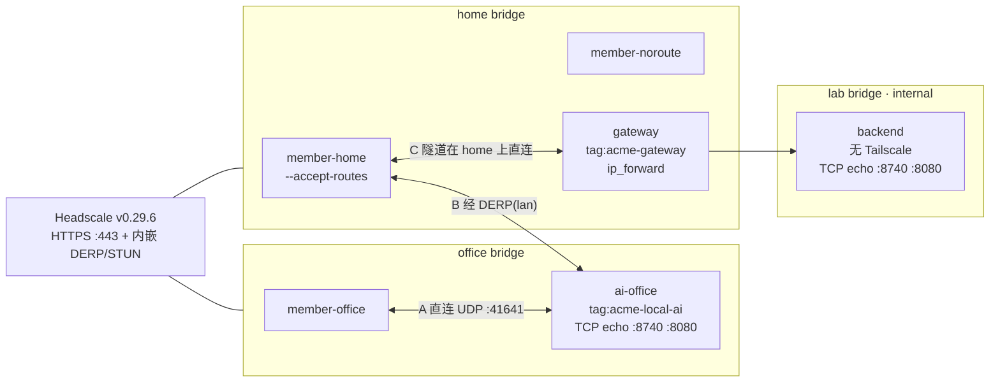

# 15 · 办公室局域网直连，以及不能装 Tailscale 的设备怎么经网关被远程成员访问

**日期：** 2026-10-27（泰国时区）· **状态：** 在 Docker 实验室里用 Headscale v0.29.6 + 官方 Tailscale v1.104.2 实测通过。回答两个产品问题。公网 NAT、Wi-Fi 隔离、VLAN、物理交换机和吞吐上限没有测，见第 6 节。

测试代码：`vpn/integration/lan_test.go`（build tag `integration`）。跑法：

```bash
cd vpn && make integration-lan
# 等价于
cd vpn/integration && go test -tags integration -count=1 -v -timeout 20m \
  -run 'TestLanDirect|TestLanAwayRelay|TestGatewaySubnetRoute' ./...
```

2026-10-27 本次通过记录：`TestLanDirect` 30.09s，`TestLanAwayRelay` 24.56s，`TestGatewaySubnetRoute` 39.63s（含 `ManualApprove` 11.73s、`AutoApprovers` 5.01s）。`make lint` 与 `golangci-lint run --build-tags integration ./integration/` 均为 0 issues。每次测试用独立的 compose 项目名 `idoris-vpn-lan-<随机>` 和随机 `10.240–254` 网段，结束时 `docker compose down -v`。

## 1. 要回答的问题

一个大约十几人的组织，办公室局域网里有一台 Local AI 主机。成员在办公室用，也从家里用。

1. 同一办公室局域网里的两台已经加入 tailnet 的机器，会不会**自己走局域网直连**（不经 DERP 中继），从而快、并且断外网也能通？要不要额外配置？
2. 一台**不能跑 Tailscale** 的设备（NAS、AI 盒子）怎么被家里的成员访问？办公室里的一台网关（subnet router）要配哪些东西？

## 2. 测过的拓扑

三条 Docker bridge，IPv6 关闭。Headscale 同时挂在 `office` 和 `home` 上，不挂 `lab`。`lab` 设了 `internal: true`。



| 测试 | 节点 | 断言 |
|---|---|---|
| `TestLanDirect` | `member-office`、`ai-office` 都在 `office` | ping 走办公室网段地址，TCP 8740 通、8080 不通 |
| `TestLanAwayRelay` | `member-home` 在 `home`，`ai-office` 在 `office` | 底下网络互不可达，ping 走 `DERP(lan)`，TCP 8740 仍通 |
| `TestGatewaySubnetRoute` | `backend` 只在 `lab`；`gateway` 同时在 `home` 和 `lab`；成员在 `home` | 批准前不可达；CLI 批准和 `autoApprovers` 都能批准；批准后 8740 通、8080 不通；没加 `--accept-routes` 的成员没有这条路由 |

实验室为了让断言成立，加了两件**产品里不需要**的隔离：

- 每个节点 `iptables` DROP 对端 bridge 的网段，避免 OrbStack 在宿主机上把两个 bridge 的 UDP 发来发去，冒充「直连」。
- `member-home` / `member-noroute` 对 lab 网段执行 `iptables -I OUTPUT -d <lab CIDR> ! -o tailscale0 -j DROP`。OrbStack 会在宿主机上把用户自定义 bridge 互相路由。不加这条规则时，成员在路由批准前就能 `nc` 到 `backend`（实测 `out="ok"`），那不是 Tailscale。包从 `tailscale0` 出去的不丢，所以批准之后的子网流量还在。

控制面沿用文档 12 的约束：节点把坐标服务器重新拨到 **443 并且强制 TLS**。实验室证书 SAN 是 DNS `headscale` 和 `127.0.0.1`，节点容器的 `SSL_CERT_FILE` 指向这张一次性 CA。CA 写在 `vpn/integration/.pki-lan/`，不进仓库。

## 3. 同一局域网：直连，不用额外配置

`member-office` 和 `ai-office` 只做了普通的 `tailscale up`（`--login-server=https://headscale --accept-dns=true --hostname=...`，AI 节点的 pre-auth key 带 `aclTags: ["tag:acme-local-ai"]`）。没有 `--advertise-routes`，没有关闭 DERP，没有指定 endpoint。

通过的那一次（项目 `idoris-vpn-lan-be7fbc`，office `10.240.36.0/24`）：

```text
tailscale ping --timeout=5s --c=10 100.64.0.2
ping "100.64.0.2" timed out
pong from ai-office (100.64.0.2) via 10.240.36.3:41641 in 1ms
```

`10.240.36.3` 是 `ai-office` 在 office bridge 上的地址，端口 41641 是 `tailscaled --port=41641`。第一下 disco 超时、下一行就是直连，往返 **1ms**。同一天早一次跑是 `via 10.241.24.3:41641 in 2ms`，再早是 `via 10.247.20.4:41641 in 5ms`，都落在当次 office 网段里。

`tailscale status --json` 里这个 peer：

```json
{"HostName":"ai-office","DNSName":"ai-office.lan.idoris.internal.",
 "TailscaleIPs":["100.64.0.2","fd7a:115c:a1e0::2"],
 "Relay":"lan","CurAddr":"10.240.36.3:41641","Online":true,
 "AllowedIPs":["100.64.0.2/32","fd7a:115c:a1e0::2/128"]}
```

活跃路径看两处：ping 行是 `via 10.240.36.3:41641`，以及 `CurAddr` 落在 office 网段。**`Relay` 仍是 `"lan"`**。Tailscale 1.104 把 `Peer.Relay` 留成 home DERP 区域代码，路径已经直连之后也不会清空。不能用 `Relay == ""` 判断直连。

数据面（内核 TUN `tailscale0`，系统 `nc`，不是 `tailscale nc`）：

```text
tailscale dns query ai-office.lan.idoris.internal
  ai-office.lan.idoris.internal.  TypeA  100.64.0.2

nc ai-office.lan.idoris.internal 8740  -> ok
nc 100.64.0.2 8740                      -> ok
nc ai-office.lan.idoris.internal 8080  -> exit status 1
nc 100.64.0.2 8080                      -> exit status 1
```

8740 和 8080 上都有 `nc -lk -e echo ok`。8080 失败是 ACL 丢包，不是端口没人听。策略是 default-deny，只放行 `acme@ -> tag:acme-local-ai:8740`。MagicDNS 名是 `<hostname>.lan.idoris.internal`（`dns.base_domain`）。

结论：同一二层/同一广播域里的两台官方客户端，注册完成之后自己选出局域网 UDP 路径。产品侧不用为「办公室直连」再加开关。断外网之后这条路径还在不在，Docker 实验室证明不了，见第 6 节。

## 4. 不在同一局域网：内嵌 DERP 能中继

`member-home` 和 `ai-office` 分属两个 bridge，互相 DROP 对端网段。底下 TCP 探测失败，说明隔离生效：

```text
nc member-home 10.247.235.3 8740  -> exit status 1
```

Headscale 打开了内嵌 DERP（`derp.server.enabled: true`，`region_id: 999`，`region_code: "lan"`，`stun_listen_addr: "0.0.0.0:3478"`，`verify_clients: true`，`automatically_add_embedded_derp_region: true`）。`derp.urls` 和 `derp.paths` 都是空的，没有公共 DERP。证书主机名和 `server_url` 的主机名都是 `headscale`。不填 DERP 的 ipv4/ipv6，客户端按 DNS 名拨号，Docker DNS 在每个网络里解析到 Headscale 自己的地址。`stun_listen_addr` 必须是 `host:port`，只写端口的话 Headscale 启动时 `SplitHostPort` 失败、进程退出。

通过的那一次（项目 `idoris-vpn-lan-da902d`）：

```text
tailscale ping --until-direct=false --timeout=5s --c=5 100.64.0.2
pong from ai-office (100.64.0.2) via DERP(lan) in 1ms
pong from ai-office (100.64.0.2) via DERP(lan) in 3ms
pong from ai-office (100.64.0.2) via DERP(lan) in 1ms
```

五次全是 `DERP(lan)`，没有一条 `via <ip>:41641`。status：`Relay` 为 `"lan"`，`CurAddr` 为空。随后系统 `nc 100.64.0.2 8740` 返回 `ok`，往返样本 **1ms**（中继和两端在同一台宿主机上，这个数字不能当成公网 DERP 延迟）。

结论：两端的 UDP 互相看不见时，这套内嵌 DERP 能把节点流量中继过去。区域代码 `lan` 是我们自己的 region 999，不是 Tailscale 的公共区域。

## 5. 不能装 Tailscale 的设备：子网网关

`backend` 只跑 TCP echo，没有 tailscaled，地址在当次 lab 网段里（通过那一次是 `10.252.119.10`，网段 `10.252.119.0/24`，项目 `idoris-vpn-lan-d63507`）。`gateway` 有两块网卡：`home` 上跑 WireGuard 端点，`lab` 上面对 backend。端点必须在被通告的前缀**外面**。只有一块 lab 网卡的话，批准路由之后端点地址会被自己通告的前缀盖住。

网关容器：`/dev/net/tun`、`NET_ADMIN`、`NET_RAW`，内核 TUN（日志里是 `tailscale0`，不是 userspace）。userspace 模式做不了「系统路由表里出现 tailscale0」这件事，`--accept-routes` 的证明会失真，所以 TUN 不存在时测试直接失败，不把 userspace 当成功。

### 5.1 批准前：通告了，但没人用

```text
headscale nodes list-routes
ID | Hostname | Approved | Available       | Serving (Primary)
3  | gateway  |          | 10.252.119.0/24 |

nc member-home 10.252.119.10 8740  -> exit status 1
```

`Available` 有、`Approved` 空、`Serving` 空。成员开了 `--accept-routes`，仍然到不了 backend。

### 5.2 手工批准

```text
headscale nodes approve-routes --identifier 3 --routes 10.252.119.0/24
Node updated
```

v0.29 的旗标是 `-i/--identifier`（节点 ID）和 `-r/--routes`。空字符串会清空已批准路由。批准后成员侧：

```text
ip route get 10.252.119.10
10.252.119.10 dev tailscale0 table 52 src 100.64.0.1

nc 10.252.119.10 8740  -> ok
nc 10.252.119.10 8080  -> exit status 1
```

路由在策略路由表 52，出口是 `tailscale0`。8740 通、8080 不通：backend 两个端口都在听，ACL 是 `acme@ -> <lab CIDR>:8740`。status 里 gateway 的 `PrimaryRoutes` 和 `AllowedIPs` 都包含 `10.252.119.0/24`，`CurAddr` 是 home 网段上的 `10.252.118.6:41641`。成员和网关共享 `home`，这条隧道是直连，不是 DERP。

### 5.3 没加 `--accept-routes` 的成员拿不到路由

```text
ip route get 10.252.119.10    # member-noroute
10.252.119.10 via 10.252.118.1 dev eth0 src 10.252.118.3

nc member-noroute 10.252.119.10 8740  -> exit status 1
```

没有 `dev tailscale0`。`via eth0` 是 OrbStack 把 lab bridge 从宿主机路由过来的，被上面的 `! -o tailscale0` 规则丢掉。真实家里的笔记本上没有这条宿主机路由，目的地在批准前就是不可达；`--accept-routes` 才是把网段装进内核的那一步。

### 5.4 `autoApprovers` 不用再跑 approve-routes

手工批准用的策略文件**没有** `autoApprovers`。另一份策略只多这一段（前缀在测试里换成当次 lab 网段）：

```hujson
"autoApprovers": {
  "routes": {
    "10.251.73.0/24": ["tag:acme-gateway"]
  }
}
```

`tag:acme-gateway` 同时写在 `tagOwners` 里。两份文件以及运行时替换后的文件都过了：

```text
headscale policy check -f <file>
Policy is valid
```

换文件后对 Headscale 发 `SIGHUP`（`docker compose kill -s HUP headscale`；容器 PID 1 就是 headscale，信号不会被壳吃掉），`policy get` 出现 `autoApprovers` 和当次网段。然后才 `tailscale up` 一台新的 `gateway-auto`（同一个 tag，通告同一个前缀）。**没有**对它调用 `approve-routes`：

```text
ID | Hostname     | Approved        | Available       | Serving (Primary)
3  | gateway      | 10.252.119.0/24 | 10.252.119.0/24 | 10.252.119.0/24
4  | gateway-auto | 10.252.119.0/24 | 10.252.119.0/24 |
```

节点 4 的 `Approved` 被策略自动填上，ID 也不是节点 3。`Serving` 仍只有节点 3：同一前缀同时有两台批准过的网关时，Tailscale 选一台做 primary。自动批准证明的是「Approved 列」，不是流量已经切到第二台。

带 tag 的节点属主是 `tagged-devices`（`gateway user=tagged-devices tags=[tag:acme-gateway]`）。pre-auth key 的 `aclTags` 能打上这个 tag；`tagOwners` 仍然要写，否则策略检查和后续按 tag 批准对不上。

### 5.5 网关配置清单

| 项 | 谁来做 | 实验室里的值 |
|---|---|---|
| 通告路由 | 网关 `tailscale up --advertise-routes=<办公室被代理网段>` | `--advertise-routes=10.252.119.0/24` |
| 给网关一个 tag | 注册时 pre-auth key 的 `aclTags` | `tag:acme-gateway` |
| `tagOwners` | 策略文件 | `tag:acme-gateway` 归 `group:admins` |
| 批准路由 | 二选一 | `headscale nodes approve-routes -i <id> -r <cidr>`，或 `autoApprovers.routes` 里这个前缀列出该 tag |
| 策略生效 | `policy.mode: file` 时改文件后 SIGHUP | `policy check` 先过 |
| 客户端接收 | 成员 `tailscale up --accept-routes` | 没有这个旗标就没有 `dev tailscale0` 的路由 |
| IPv4 转发 | 网关内核 `net.ipv4.ip_forward=1` | 见下方陷阱 |
| TUN | `/dev/net/tun` + `NET_ADMIN` + `NET_RAW` | 实测创建了 `tailscale0` |
| 网关有「出去的网卡」和「对着 NAS 的网卡」 | 端点地址不要落在被通告的前缀里 | `home` + `lab` |
| ACL | 按 CIDR **和端口** 写 | `acme@ -> 10.252.119.0/24:8740`；8080 在听也被拒 |
| 转发 | tailscaled 默认对子网路由做 SNAT | 不需要成员和 NAS 互相有路由 |

办公室里能跑 Tailscale 的 Local AI 主机走第 3 节的直连，不必绕这台网关。网关是给那些不能装客户端的设备用的。

## 6. 这个 Docker 实验室证明不了什么

- **跨互联网的 NAT 打洞。** 直连发生在同一座 bridge 上。家里路由器后面的 UDP 能不能打到办公室，这里没有测。
- **子网路由再套一层 DERP。** 第 4 节是节点到节点的 DERP。第 5 节里成员和网关共享 `home`，隧道是直连（`CurAddr` 在 home 网段）。「人在 NAT 后、网关也在 NAT 后、子网流量走 DERP」没有测。
- **Wi-Fi 客户端隔离、VLAN、物理交换机。** 同一 bridge 不等于办公室无线 AP 允许终端互访。AP 开了客户端隔离时，两台机器会掉回 DERP，即使人还坐在同一间办公室。
- **断外网之后直连是否还在。** 控制面和 DERP 都在这台宿主机上，没有拔过上联。
- **吞吐和丢包。** 样本是 1ms 级的 `tailscale ping` 和一次 `nc` 回包 `ok`。没有 iperf，没有大文件。
- **第二台自动批准的网关是否能独立转发。** `gateway-auto` 的 Approved 有值，Serving 为空。流量断言打在 primary（`gateway`）上。

## 7. 踩过的坑

- **`Peer.Relay` 不是活跃路径。** 直连时它仍是 `"lan"`。看 ping 行和 `CurAddr`。
- **`tailscale nc` 不能当 echo 客户端。** 连上 MagicDNS:8740 时退出码 0，标准输出是空的。`tailscale nc` 在 stdin EOF 时关掉写方向，busybox `nc -e echo` 来不及回 `ok`。数据面用系统 `nc` 打进 `tailscale0`。
- **MagicDNS 可用，但改不了 Docker 的 resolv.conf 文件名。** 日志是 `rename /etc/resolv.conf ... device or resource busy, falling back to copy+delete`。`--accept-dns=true` 之后查询仍返回 `TypeA 100.64.0.2`。`tailscale up` 之前要把 `headscale` 写进 `/etc/hosts`，否则 DNS 被接管后坐标服务器名字会丢。
- **OrbStack 上 `sysctl -w net.ipv4.ip_forward=1` 返回 Read-only file system。** 读出来已经是 `net.ipv4.ip_forward = 1`，所以转发是开的，写不进去。`tailscale up` 仍警告 `IPv6 forwarding is disabled`。另外 `net.ipv4.conf.all.src_valid_mark` 也是只读，tailscaled 打出 `failed to enable src_valid_mark` 后继续跑，子网路由这次仍然通了。真实 Linux 网关上 IPv4 转发默认经常是 0，而且要能写：`sysctl -w net.ipv4.ip_forward=1`，并写进 sysctl.d。只读还是 0 的环境，这份测试会在断言 `= 1` 处失败，而不是假装通过。
- **不要在成员上 DROP 整个 lab 网段。** 那样会把已经批准、要从 `tailscale0` 出去的包一起丢掉。DROP 的是「出口不是 tailscale0」的那部分，而且只为了抵消 Docker 宿主机的跨 bridge 路由。
- **策略里的 `tests` 块在还没有节点时会让 `policy check` 失败**（src/dst 解析不到节点）。实验室策略不写 `tests`。
- **同一前缀的模板地址**写在仓库里的策略文件中（`10.251.73.0/24`），测试启动时替换成当次随机网段再挂进容器。`headscale policy check` 对模板和替换后的文件都返回 `Policy is valid`。
