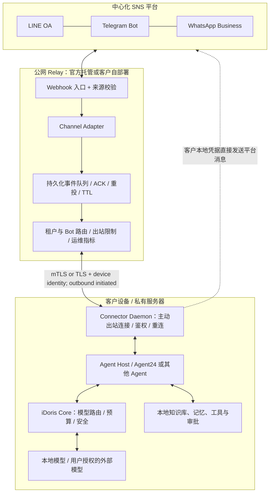

# iDoris SNS Bridge — 技术架构与里程碑 v0.1

**日期：** 2026-10-21  
**性质：** 架构提案，尚未实施或验证仓库兼容性  
**定位：** 可自部署、开源、本地优先的 SNS 通信桥接插件；不是新 Agent 平台，也不是推理 SaaS。

## 0. 产品契约

- 用户拥有自己的 LINE Official Account、Telegram Bot、WhatsApp Business 账户/号码。
- 用户本地已有 Agent24 / iDoris 能力；Bridge 不复制 Agent、RAG、模型调度、记忆、工具调用系统。
- Relay 负责公网入口与消息交付；本地 Connector 负责 Agent 适配；Agent24 是默认 Agent Host；iDoris 是底层模型选择、资源容量、预算、生命周期及安全决策内核。外部兼容 Agent 亦可作为 Agent Host，无需依赖 iDoris。
- Relay 必须稳定公网可达，但不需要所有用户都使用 iDoris 官方 Relay；客户可以自行部署自己的 Relay。用户本地无需开放公网端口。
- 官方托管 Relay 是可收费的运维服务，不代替客户本地模型/知识库。

## 1. 总体架构



设计目标是双向的消息桥，**不是公网反向代理到本地 Agent 的任意接口**。iDoris Admin API 与 Agent24 的特权 IPC 不应暴露到 Relay。

## 1.1 与既有仓库的真实集成状态（根据 2026-10-21 读取的 main README）

- [Agent24 README](https://github.com/iDoris-ai/Agent24/blob/main/README.md) 说明生产核心已是 Rust `agent24d`，它提供本地 `/api/v1` REST+WebSocket 的 sessions/runs/approvals 能力，Electron 是参考 UI；**本项目不能重写 Agent Loop 或把 Electron 当成必须常开的唯一宿主**。
- Agent24 已有**进程外领域 OS** 扩展机制、`agent24-os-sdk`（0.1.0 原型）及 `agent24 os install` 机制。`sns-connector` 应优先评估以进程外 OS 包或 Attached 模块形式接入；如果现有 OS SDK 不包含所需会话运行 API，再选择受约束的 v1 REST/WS Adapter。无论如何，SNS Connector 对非 Agent24 的 Agent 还应可独立运行。
- Agent24 当前 README 明确：生产模型启动主要接 oMLX/Ollama；与 iDoris 的 Provider 集成仍在 P4 门后，**不得假定 Agent24 → iDoris 的默认路由已经上线**。该集成属于外部依赖，需要在 G1 前做接口验收并单独列阻塞项。
- [iDoris README](https://github.com/iDoris-ai/iDoris/blob/main/README.md) 显示 Rust 是唯一生产实现；数据面默认 `127.0.0.1:8740`、Admin 默认 `127.0.0.1:8741`。Bridge 绝不能调用或代理公网 Admin 路由，不能将本地虚拟密钥交给 Relay。
- Agent24 的进程外领域 OS 与内核通常同 UID，并非安全沙箱；来自外部 SNS 的内容一律为不可信数据。扩展权限边界必须由 agent24d 的实际 auth/policy/approval 机制强制，不得仅凭模块 Manifest 的声明当成隔离承诺。

## 2. 模块与责任

| 模块 | 职责 | 不负责 |
|---|---|---|
| `relay-server` | HTTPS Webhook、验签、持久队列、租户路由、限流、超期清理 | 模型推理、知识库、业务执行 |
| `channel-line` | LINE 签名、事件、媒体、reply token / push 语义 | 模型决策 |
| `channel-telegram` | Telegram secret token、事件、发送 API、群权限 | 业务工具 |
| `channel-whatsapp` | Meta webhook、业务号码映射、模板/回复窗口政策 | AI Agent |
| `connector-daemon` | 出站持久安全连接、消息 ACK、Agent 调用、状态健康、凭据库 | 多渠道公网站点 |
| `agent24-adapter` | 调用 agent24d 已有的 REST/WS 会话、运行、审批契约；优先复用进程外 OS/Attached 机制 | 重复实现 Agent Loop 与模型路由 |
| `agent-a2a-adapter` | 调用标准 A2A Agent、任务状态 | 声称任意 OpenAI Chat API 都等于 Agent |
| `owner-ui` | Bot 绑定、权限、预算、连接状态、错误排查 | 保存用户 LINE 登录密码 |

## 3. 接入与配对流程

1. 客户在自己的设备上安装 `connector-daemon`，Agent24 通过本机 UI 管理；优先复用已有 agent24d 与进程外模块启动管理，不把 Electron 生命周期当成服务生命周期。
2. Connector 本机生成设备密钥；用一次性短期 pairing code 与 Relay 建立 **device_id / organization_id / allowed_channels** 绑定，确认后换取短期凭据。拒绝任意设备直接声明任意 tenant ID。
3. 客户选择 LINE / Telegram / WhatsApp，依据官方流程创建或授权自己的账号。LINE 普通 Messaging API 初版使用人工辅助初始化，不假设存在开放的一键 OAuth 授权 API。
4. Connector/管理界面读取 Bot 基本身份信息，客户确认 **具体 Bot → 指定 Agent** 绑定。配置平台 Webhook 指向 Relay；需要发布前测试。
5. Gateway 存必要的 webhook 验证材料；**发送 API Token 默认保存在本地 OS 密钥库**，由 Connector 直接调用平台出站 API。若希望 Relay 代为离线告知，需客户单独授权并承担扩大凭据托管范围的风险。
6. LINE 依据原始请求 body 与 Channel Secret 做 HMAC-SHA256 签名验证；Telegram 配置每个 Bot 独立 `secret_token`；WhatsApp 按 Meta app webhook 验证流程。所有配置验证均失败关闭。
7. 客户发一条真实测试消息 → Relay 验证 → Connector 收取 → Agent 回复 → 客户看到消息 → 确认交付。解绑时停止分发、清空授权、主动撤销或指引轮换凭据。

> 隐私模式扩展（非 G1）：可将签名校验下沉到 Connector，Relay 只转发原始 webhook 加密负载、限制速率。缺点是 Relay 不能独立完成平台来源认证，滥用防御较弱。无论哪种模式，平台与公网入口仍可能在收到原始消息的瞬间看到明文；不要宣称跨平台端到端零知识。

## 4. 消息生命周期

1. `provider webhook` → **原始请求验签** → `channel + bot + tenant` 唯一映射 → schema/体积校验。
2. 生成内部 `event_id`（优先采用平台 ID + scoped bot ID）；持久化后再向平台返回 `2xx`。Relay 与 Connector 双重幂等；平台重试不重复执行业务动作。
3. 保证**同一会话的合理顺序**，不同会话可并发；为乱序事件提供 timestamp 和原始事件 ID。投递模式 `at-least-once`，消费端 idempotent，不承诺网络层 exactly-once。
4. Connector 通过自身建立的 TLS 长连接接收事件，校验 `device_id/tenant/channel` 授权，再发给绑定的本地 Agent。
5. Agent24 处理对话、知识库、工具与批准流程，必要时调用 iDoris 选择本地或外部模型。返回标准化消息块和执行状态。
6. Connector 基于渠道 capabilities 选择回复方式并由本地渠道凭据发送到外部平台；结果与发送回执反馈给 Relay 的事件状态机。**Agent 输出不能任意选择 recipient**，收件人必须来自用户授予的会话绑定或显式发送授权。
7. 消息状态示例：`accepted → queued → delivered → executing → awaiting_approval → outbound_pending → sent/failed/expired`。

### 平台差异不能抹平

- **LINE：** reply token 只能使用一次，通常要在收到 webhook 后一分钟内使用；长运行 AI 推理可能错过回复窗口。需要 `reply_deadline`、客户允许的 Push fallback、额度预算和超期默认处理；不能静默改成付费主动推送。
- **Telegram：** Bot API webhook 或 `getUpdates` 二选一。可允许高级用户 `getUpdates` 本地直连模式（不需要公网 Relay），但不作为统一产品默认模式。
- **WhatsApp：** 独立建模用户服务窗口、模板消息及政策约束；只启用符合平台用途的商家业务 Agent，不向开放式通用聊天场景默认开通。
- **媒体：** 限制文件大小、类型与下载域；避免 URL SSRF；按授权临时拉取，不在 Relay 永久存照片/语音。
- **群组：** 默认仅响应 @提及、斜杠命令或明确触发条件；将同群参与者视为不同身份，严禁无许可读取其他会话或本地私有工具。

## 5. 标准接口

协议应版本化：`sns-bridge/1`。内部 Event Envelope（示意）：

```json
{
  "version": "sns-bridge/1",
  "event_id": "provider:channel:bot:event",
  "organization_id": "org_...",
  "binding_id": "binding_...",
  "channel": "line",
  "conversation": {
    "id": "provider-scoped-id",
    "kind": "direct",
    "sender_id": "provider-scoped-user-id"
  },
  "message": {
    "type": "text",
    "text": "今天还有法棍吗？"
  },
  "response_policy": {
    "mode": "reply",
    "expires_at": "2026-10-21T04:15:00Z",
    "allow_paid_push_fallback": false
  },
  "trace_id": "trace_..."
}
```

这仅是业务内部 Envelope；`sender_id` 必须限制在 channel / Bot 身份域，不得自动跨 LINE、Telegram 合并用户身份。外部凭据、LINE reply token 应放在受保护的渠道元信息中，不能暴露给模型提示词、工具或审计日志。服务端接受的 `organization_id` 由授权绑定决定，不能信任外部请求自带的值。

建议接口分三层：

- `ChannelAdapter`：`verifyWebhook(raw, headers)`、`parseEvents`、`sendMessage`、`capabilities`、`provisioningStatus`。
- `ConnectorWire`：`connect`、`subscribe`、`ack`、`result`、`heartbeat`、`resume(cursor)`，TLS + 设备身份 + 消息签名与版本协商；支持断线重投。
- `AgentAdapter`：`capabilities`、`startOrContinueSession`、`pollTask`、`cancel`、`requestApproval`。默认实现 Agent24 Native Adapter；为其他 Agent 实现 A2A Adapter；MCP 属于 Agent 的**工具**接口，而不是 SNS 事件投递协议。单纯 OpenAI-compatible Chat Completions 只能作为受限文本型兼容层，不能保证 Agent 审批/任务语义。

建议定义 `ChannelCapabilities`：`reply_deadline`、`push_allowed`、`media_types`、`max_payload_bytes`、`group_events`、`message_edit`、`async_reply`、`cost_class`，以免不同平台的特殊规则丢失。

## 6. 本地运行与故障管理

- Connector 使用 Rust/Tokio，独立 OS daemon/launchd/systemd 服务；Agent24 仅提供 UI，不依赖 UI 一直开启。
- 每个组织可配置多个本地 Agent Device：明确一个 active owner（租约/fencing token），只允许一个消费者执行会产生副作用的消息；冷备节点可接管。主控进程重启时保证幂等。
- Relay 在本地离线时保存有界、加密、短 TTL 的事件队列；到期则安全丢弃并记录非敏感错误。**队列接收成功不等于客户得到回答**；UI 明确显示 `offline / expired / awaiting_approval`。
- 可选店主授权的离线模板回复；如果必须由 Relay 发，需单独托管授权的发送能力。默认绝不自动转发到 iDoris 云模型，也不将本地知识库存到 Relay。
- Webhook 快速返回 2xx，不等待模型推理；队列数据库事务提交成功才返回；失败返回适当错误让平台有机会重投。
- 建议 MVP 使用 PostgreSQL event/outbox + `SKIP LOCKED` 租赁，不急于增加 NATS/Kafka；量级扩大之后再抽象队列后端。

## 7. 安全与隐私边界

| 威胁 | 规则 |
|---|---|
| 伪造平台 Webhook | 验证未经变换的原始 body、平台签名或 secret token，失败拒绝 |
| 跨租户消息/越权回发 | token 绑定 tenant + Bot + device + scope；路由由可信映射决定，所有层验证 |
| Relay 入侵 | Relay 不能访问本地 Agent Admin、知识库、任意文件或工具；最小 secrets / 短 TTL |
| 重试重复扣款/重复发消息 | 事件与 side effect 双重幂等、outbox、操作唯一键 |
| 提示词注入/群消息诱导 | SNS 文本永远视为不可信输入；高风险工具人类审批；只允许预定义工具 |
| 预算与资费失控 | 渠道消息 quota、成本上限、出站 allowlist，付费 Push 默认拒绝 |
| Relay 越权查看内容 | 明文入口最短驻留、TLS、加密队列、PII 日志脱敏、可配置不保留 |
| 用户删除 / 解绑 | 撤销 token、删除消息缓存与索引、尊重 LINE unsend 和组织删除策略 |
| 设备窃取 | OS Keychain/Secret Service、设备吊销、短期凭据、轮换，不使用长期静态共享 token |

上线前完成泰国 PDPA 等适用隐私义务的评估，包括数据存储位置、跨境流动、用户告知和删除流程。

## 8. 推荐代码结构

```text
sns-bridge/
  crates/
    sns-protocol/           # Envelope / capabilities / schema / version
    relay-server/           # Webhook, queue, routing, leases, observability
    connector-daemon/       # local outbound connection, credential storage
    channel-line/
    channel-telegram/
    channel-whatsapp/
    agent-adapter-agent24/
    agent-adapter-a2a/
  migrations/               # PostgreSQL
  deploy/                   # single node docker compose / production examples
  docs/                     # security model, API, onboarding, operations, RFCs
  tests/                    # contract, platform fixture, fault injection, E2E
```

把本项目作为 iDoris 体系下的独立开源仓库；通过版本化本地 Agent Host Adapter 和现有 Agent24/iDoris 接口集成，尽量不侵入 iDoris 内核、不复制现有路由/安全策略。

## 9. 里程碑与验收标准

| 阶段 | 主要交付 | 可客观验收的 Exit Criteria |
|---|---|---|
| **G0 合同与安全基线** | ADR、威胁模型、Envelope v1、Channel/Agent 接口、离线语义、凭据归属 | 完成伪造 webhook、跨租户、过期 reply、side-effect 重试测试设计；协议可 mock 跑通 |
| **G1 LINE 纵向闭环** | LINE Adapter、单节点 Relay、Connector 守护进程、Agent24 适配、Webhook/发送、配对向导；明确 P4/iDoris Provider 依赖 | 客户自有 OA → 本地 Agent24 Agent Loop → 当前可用本地模型 → Reply 成功；iDoris 路由场景需等 P4 真正对接后单独通过端到端验收，不能模拟为已完成；离线/重复消息/错误签名 fail-closed |
| **G2 Telegram 与开放 Agent** | Telegram Adapter、BotFather/manual 接入、Managed Bot 选型、A2A Agent Adapter | 相同 Agent 能在 LINE 与 Telegram 回答；外部 A2A Agent 替换 Agent24 无需改 SNS 协议 |
| **G3 可靠性与正式运维** | 多租户、Postgres 队列、可观测性、quota、配额预警、数据删除、Docker 自部署 | 断网/重启后有界恢复、不重复执行；租户隔离与 token 吊销经过实测；官方 Relay 与自部署兼容 |
| **G4 WhatsApp 合规接入** | Meta Cloud API、Embedded Signup 可行性核查、发送窗口/模板状态机 | 商业账号授权与解绑可用；政策/额度拒绝路径有测试；不把通用 AI 助手视作默认可用场景 |
| **G5 开源发布/运营** | 许可证审查、社区文档、示例 Agent、CI、版本升级与迁移、运维手册 | 陌生开发者仅靠文档完成自部署；托管/自部署端协议一致；数据迁移与退订可执行 |

**PR 管控：** 每个阶段拆成小型可审 PR；生产代码改动尽量 ≤300 行，特殊情况说明；保持独立分支/worktree；fmt、Clippy、协议与安全测试、CI 通过后才合并。SNS `G*` 与 iDoris 核心 `M*` 里程碑相互独立，避免阻塞既有项目。

## 10. 部署形式与商业边界

### A. 官方托管 Relay + 本地 Agent（面向普通小商家）
- iDoris 运营中心 Relay、TLS、队列、监控、升级与客服。
- 用户拥有 SNS 账号和本地 Agent 的模型与知识库，iDoris 不收取这些外部平台的代付通信费（除非未来客户主动选择代付）。
- 收费对象是**Relay 托管和通信运营服务**，不是推理 SaaS。

### B. 客户自部署 Relay + 自有 Agent
- 同一开源代码，自有域名、公网服务器、凭据及监控。
- 仍须遵守 LINE/Meta/Telegram 平台规则，支付相应账号和消息费用；不会因自部署豁免平台费用。

### C. 特殊直连
- Telegram 可选择本地 `getUpdates` long polling，避开 Relay；LINE/Meta Webhook 一般仍需公网可达 HTTPS 入口。

**开源许可策略：** 接口协议和 SDK 可以考虑 Apache-2.0；Relay 可根据对商业托管竞争与生态传播的取舍选择 Apache-2.0 或 AGPL-3.0，但变更现有 iDoris/Agent24 代码许可前必须审查版权与现有许可证。不应将托管基础设施视为唯一壁垒；更强的价值是易用性、可靠性、平台准入、部署支持与跨平台兼容。

## 11. 决策清单（默认建议）

1. 项目名 `SNS Bridge`：**通过**。不建立新的 Agent Core。
2. Rust-only 生产实现：**通过**。所有接口用版本化协议定义。
3. Agent24 Native Adapter 优先，A2A 第二：**通过**。MCP 仅用于 Agent 内部工具。
4. Relay 只接受 Webhook / 投递 / 发送运营：**通过**。不能调用 iDoris Admin 或本地任意 API。
5. 发送平台 token 本地保存；Relay 仅保存必要入站校验材料：**默认**，需验证各平台实际配额与机制。
6. 先 LINE 闭环，再 Telegram，再 WhatsApp：**通过**；Agent24→iDoris Provider 当前是否生产就绪作为 G0/G1 验收依赖核查。
7. 先单机持久队列再 HA；成本、可靠性和协议安全先于复杂基础设施：**通过**。
8. G0 结束前需明确：LINE 长任务的超时/Push fallback UX、租户绑定凭据归属、Relay 明文瞬时处理的隐私声明。

## 12. 官方参考

- LINE 验签：https://developers.line.biz/en/docs/messaging-api/verify-webhook-signature/
- LINE Webhook 与重投：https://developers.line.biz/en/docs/messaging-api/receiving-messages/
- LINE Reply token：https://developers.line.biz/en/reference/messaging-api/#send-reply-message
- Telegram Bot API：https://core.telegram.org/bots/api
- Telegram Managed Bots：https://core.telegram.org/api/bots
- WhatsApp Cloud API Webhook：https://www.postman.com/meta/whatsapp-business-platform/folder/tduohwq/webhook-payload-reference
- A2A 规范：https://a2a-protocol.org/v0.3.0/specification/
- MCP 规范：https://modelcontextprotocol.io/specification/2026-07-28
